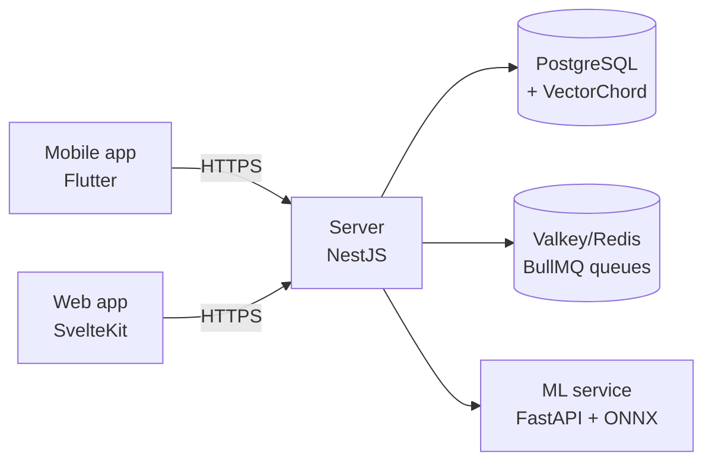

# HomeRoll — self-hosted photo & video backup and gallery

<div align="center">

[](docker/docker-compose.yml)
[](server)
[](docs/project.md)
[](LICENSE)
[](https://github.com/alzimerahmed/HomeRoll/actions/workflows/test.yml)

*A self-hosted photo and video backup and gallery — mobile auto-backup, semantic search, facial recognition, and sharing on hardware you control. Forked from Immich v3.3.0-rc.0.*

[Quick Start](#quick-start) • [Features](#features) • [Tech Stack](#tech-stack) • [Roadmap](#roadmap)

</div>

---

## Features

Verified against the codebase (fork of Immich v3.3.0-rc.0):

- **Backup & ingest** — mobile auto/background backup with selective albums, duplicate detection, external libraries, CLI bulk import (`packages/cli`), user-defined storage templates
- **Desktop ingestion** — `immich upload --watch ~/Photos` keeps a local folder continuously synced to the server (new/changed files are uploaded automatically; the supported desktop watch-folder path)
- **Organize** — albums and shared albums, stacked photos, hierarchical tags, favorites/archive, folder view, trash, PIN-locked folder
- **Discover** — CLIP semantic search, OCR text search, facial recognition and clustering, metadata search (EXIF), memories ("x years ago"), global map, duplicate detection
- **View & play** — Live Photos / Motion Photos, 360° photos, RAW formats, HLS video transcoding, slideshow, Chromecast, virtual-scrolled timeline
- **Share** — partner sharing, public shared links (optionally accepting uploads), album comments and likes
- **Platform** — multi-user, OAuth/OIDC, API keys, generated OpenAPI SDKs, Extism WASM plugin system, PWA, offline-capable mobile app, local-only telemetry (no phone-home)

---

## Tech Stack

| Layer | Technology |
|---|---|
| Server | NestJS 12 + Express 5, TypeScript, Zod DTOs |
| Web | SvelteKit 2 + Svelte 5, Tailwind CSS 4 |
| Mobile | Flutter 3.47 / Dart, Riverpod, drift, auto_route |
| Machine learning | FastAPI + ONNX Runtime (cpu/cuda/openvino/armnn/rknn/rocm), uv |
| Database | PostgreSQL + VectorChord (pgvectors fallback), Kysely |
| Jobs & realtime | BullMQ + Valkey/Redis, socket.io |
| API contract | OpenAPI spec → TS SDK (oazapfts) + Dart SDK (openapi-generator) |
| Native | Rust crates for mobile acceleration |
| Tooling | mise (pinned toolchains), pnpm 11 monorepo |



---

## Project Structure

```
├── server/              NestJS API, job workers, DB schema (Kysely)
├── web/                 SvelteKit web client
├── mobile/              Flutter app — backup + gallery
├── machine-learning/    FastAPI inference service (CLIP, faces, OCR)
├── packages/            Workspace pkgs: sdk, cli, plugin-sdk, plugin-core, scripts
├── open-api/            OpenAPI spec + SDK generation
├── i18n/                Locale files (en.json is source of truth)
├── docker/              docker-compose deployment files
├── native/              Rust crates for mobile native code
├── e2e/                 API + web end-to-end tests
└── docs/                Docusaurus documentation site
```

---

## Quick Start

Requires Docker and Docker Compose.

1. Download the deployment files:

   ```bash
   mkdir homeroll && cd homeroll
   curl -O https://raw.githubusercontent.com/alzimerahmed/HomeRoll/main/docker/docker-compose.yml
   curl -O https://raw.githubusercontent.com/alzimerahmed/HomeRoll/main/docker/example.env
   mv example.env .env
   ```

2. Edit `.env`: set `UPLOAD_LOCATION` (where your library is stored) and change `DB_PASSWORD`.

3. Start the stack:

   ```bash
   docker compose up -d
   ```

   Open `http://localhost:2283` and create the admin account.

> [!NOTE]
> The compose file currently pulls upstream `ghcr.io/immich-app/*` images. Publishing HomeRoll-branded images as `ghcr.io/alzimerahmed/homeroll-*` is planned but not yet live — the compose file and `IMMICH_VERSION` pin will be updated when they are.

---

## Roadmap

Fork-critical and planned work (tracked in `docs/idea.md`):

- [ ] HomeRoll branding pass (strings, logos, doc/support links)
- [ ] Remove upstream monetization (`/buy` flow, license endpoints)
- [ ] Repoint or disable the `version.immich.cloud` version check
- [ ] Publish `ghcr.io/alzimerahmed/homeroll-*` container images
- [ ] Google Takeout / bulk import wizard
- [ ] Smart (rule-based) albums and nested albums
- [ ] RSS/Atom + Open Graph embeds for shared links
- [ ] WebDAV read endpoint
- [x] Desktop watch-folder uploader (CLI `immich upload --watch`)
- [ ] Conversational search ("Ask HomeRoll")
- [ ] Visual regression + accessibility test layer

---

## Acknowledgements

HomeRoll is a fork of [Immich](https://github.com/immich-app/immich) (v3.3.0-rc.0). All credit for the underlying platform goes to the Immich authors and contributors. HomeRoll remains licensed AGPL-3.0 as a derivative work; upstream copyright notices are preserved.

---

## License

[AGPL-3.0](LICENSE) — © Immich contributors (upstream) and Alzimer Ahmed (HomeRoll changes). Because AGPL §13 treats network use as distribution, hosted HomeRoll deployments must offer their source.
