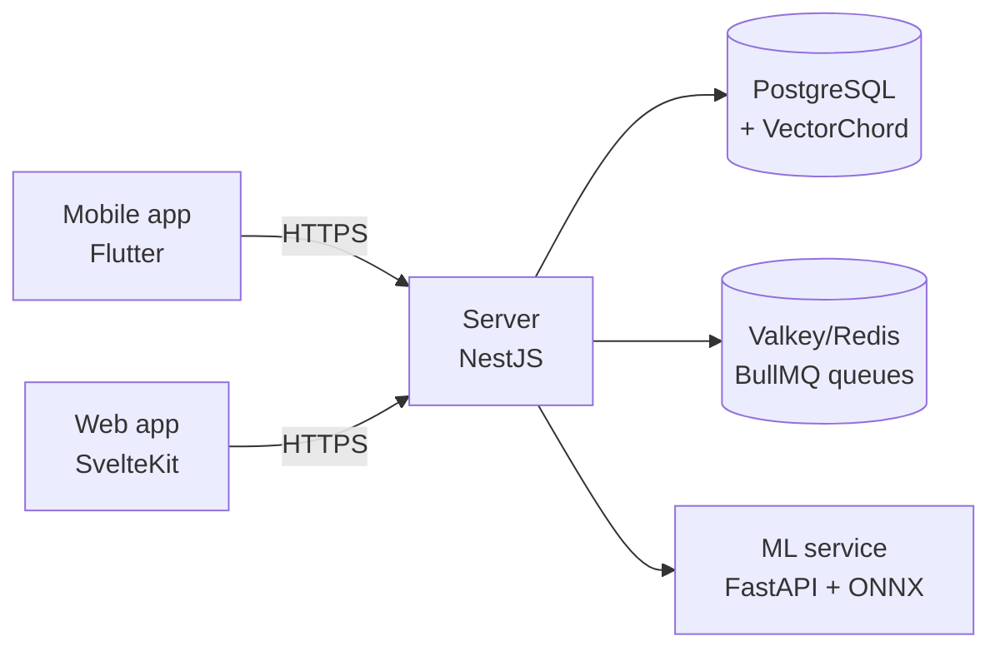

# HomeRoll — self-hosted photo & video backup and gallery

<div align="center">

[](docker/docker-compose.yml)
[](server)
[](AGENTS.md)
[](mobile)
[](LICENSE)
[](https://github.com/alzimerahmed/HomeRoll/actions/workflows/test.yml)

*A self-hosted photo and video backup and gallery for people who want their memories on hardware they own — mobile auto-backup, semantic search, facial recognition, and sharing, with no telemetry and no subscription. Forked from Immich.*

[Download](https://github.com/alzimerahmed/HomeRoll/releases) • [Quick Start](#quick-start) • [Features](#features) • [Tech Stack](#tech-stack) • [Roadmap](#roadmap)

</div>

---

## Features

- **Backup & ingest** — mobile auto/background backup with selective albums, duplicate detection, external libraries, CLI bulk import, user-defined storage templates
- **Desktop ingestion** — `immich upload --watch ~/Photos` keeps a local folder continuously synced to the server; Google Takeout archives import server-side with EXIF-from-JSON pairing
- **Organize** — albums and shared albums, nested albums, rule-based smart albums, stacked photos, hierarchical tags, favorites/archive, folder view, trash, PIN-locked folder
- **Discover** — CLIP semantic search, OCR text search, "Ask HomeRoll" conversational search, facial recognition and clustering, metadata search (EXIF), browsable label taxonomy, memories ("x years ago"), global map, duplicate detection, hidden photos
- **View & play** — Live Photos / Motion Photos, 360° photos, RAW formats, HLS video transcoding, in-viewer video trim, slideshow, Chromecast, virtual-scrolled timeline, auto-generated collages and trip highlights
- **Share** — partner sharing, public shared links (optionally accepting uploads) with Open Graph embeds and RSS/Atom feeds, album comments and likes, OS push notifications for shared-album and backup events
- **Portability** — export originals with metadata sidecars (XMP + Takeout-compatible JSON); read libraries over WebDAV
- **Platform** — multi-user, OAuth/OIDC, API keys, generated OpenAPI SDKs, Extism WASM plugin system, PWA, offline-capable mobile app, local-only telemetry (no phone-home)

---

## Tech Stack

| Layer | Technology |
|---|---|
| Server | NestJS 12 + Express 5, TypeScript, Zod DTOs |
| Web | SvelteKit 2 + Svelte 5, Tailwind CSS 4 |
| Mobile | Flutter 3.47 / Dart, Riverpod, drift, auto_route |
| Machine learning | FastAPI + ONNX Runtime (cpu/cuda/openvino/armnn/rknn/rocm), uv |
| Database | PostgreSQL + VectorChord (pgvectors fallback), Kysely |
| Jobs & realtime | BullMQ + Valkey/Redis, socket.io |
| API contract | OpenAPI spec → TS SDK (oazapfts) + Dart SDK (openapi-generator) |
| Native | Rust crates for mobile acceleration |
| Tooling | mise (pinned toolchains), pnpm 11 monorepo |



---

## Project Structure

```
├── server/              NestJS API, job workers, DB schema (Kysely)
├── web/                 SvelteKit web client
├── mobile/              Flutter app — backup + gallery
├── machine-learning/    FastAPI inference service (CLIP, faces, OCR)
├── packages/            Workspace pkgs: sdk, cli, plugin-sdk, plugin-core, scripts
├── open-api/            OpenAPI spec + SDK generation
├── i18n/                Locale files (en.json is source of truth)
├── docker/              docker-compose deployment files
├── native/              Rust crates for mobile native code
├── e2e/                 API + web end-to-end tests
└── docs/                Docusaurus documentation site
```

---

## Quick Start

Requires Docker and Docker Compose.

```bash
mkdir homeroll && cd homeroll
curl -O https://github.com/alzimerahmed/HomeRoll/releases/latest/download/docker-compose.yml
curl -O https://github.com/alzimerahmed/HomeRoll/releases/latest/download/example.env -o .env
docker compose up -d
```

Or the one-liner installer, which does the same and generates a random `DB_PASSWORD`:

```bash
bash <(curl -fsSL https://raw.githubusercontent.com/alzimerahmed/HomeRoll/main/install.sh)
```

Then open `http://localhost:2283` and create the admin account.

<details>
<summary>Configuration notes</summary>

- Set `UPLOAD_LOCATION` in `.env` to the directory where your library should be stored.
- The compose file pulls `ghcr.io/alzimerahmed/homeroll-server` and `ghcr.io/alzimerahmed/homeroll-machine-learning` at tag `release` by default; pin a specific version with `IMMICH_VERSION` in `.env` (e.g. `IMMICH_VERSION=v1.0.0`).
- A PostgreSQL + VectorChord image is pulled from upstream `ghcr.io/immich-app/postgres` — HomeRoll does not rebuild the database image.
- Reverse proxy / TLS, hardware transcoding (`hwaccel.transcoding.yml`), overlays live in `docker/` (ML hw-accel variants need locally built images — only the cpu image is published).

</details>

<details>
<summary>Mobile app</summary>

Signed APKs (universal and per-ABI) and the Play-ready AAB ship as release assets on [GitHub Releases](https://github.com/alzimerahmed/HomeRoll/releases) — applicationId `com.github.alzimerahmed.homeroll`. Install the APK, point it at your server URL, and enable background backup.

</details>

---

## Usage

Typical first-run flow:

1. `docker compose up -d` → create the admin account at `http://<host>:2283`.
2. Install the mobile app → enter the same URL → toggle **Backup** for your camera album. Uploads run in the background over Wi-Fi.
3. From the web UI: create an album, share it publicly with Open Graph previews, or watch the ML service index faces and objects as assets land.
4. On a desktop, keep a watched folder syncing: `immich upload --watch ~/Photos --recursive`.

---

## FAQ / Troubleshooting

- **Containers fail to start with a DB password error** — delete `.env`'s default `DB_PASSWORD=postgres` and set a real one before the first `up`. The installer script does this for you.
- **Smart search / facial recognition is slow** — the ML container downloads model weights on first use; subsequent runs are cached in the `model-cache` volume.
- **Mobile backup stalls on cellular** — backup is Wi-Fi-only by default; toggle it in app settings.

---

## Roadmap

- [x] HomeRoll branding pass — icon, display name, applicationId/bundle ID, splash, deep-link schemes
- [x] Upstream monetization removed (`/buy` flow, license endpoints, donation links)
- [x] `ghcr.io/alzimerahmed/homeroll-*` container images on every release
- [x] Signed Android releases on GitHub Releases (universal + per-ABI APK, AAB)
- [x] Google Takeout import, desktop watch-folder ingestion, WebDAV read endpoint
- [x] Smart + nested albums, hidden-photos surface, browsable label taxonomy
- [x] "Ask HomeRoll" conversational search, memory quality scoring, auto-creations, video trim
- [x] Export with metadata sidecars (XMP + Takeout JSON)
- [x] RSS/Atom + Open Graph shared links, OS push notifications
- [ ] `IMMICH_*` env var / service-name rename (breaking-change release with compat shim)
- [ ] Play Store / F-Droid listing
- [ ] E2EE at rest (deferred in `docs/idea.md`)

---

## Changelog

See [GitHub Releases](https://github.com/alzimerahmed/HomeRoll/releases) — every tag publishes release notes plus downloadable artifacts.

---

## Contributing

Fork → branch → PR against `main`. Conventional Commits (`type(scope): description`), CI must be green. See [CONTRIBUTING.md](CONTRIBUTING.md).

---

## Acknowledgements

HomeRoll is a fork of [Immich](https://github.com/immich-app/immich). All credit for the underlying platform goes to the Immich authors and contributors. HomeRoll remains licensed AGPL-3.0 as a derivative work; upstream copyright notices are preserved.

---

## License

[AGPL-3.0](LICENSE) — © Immich contributors (upstream) and Alzimer Ahmed (HomeRoll changes). Because AGPL §13 treats network use as distribution, hosted HomeRoll deployments must offer their source.
